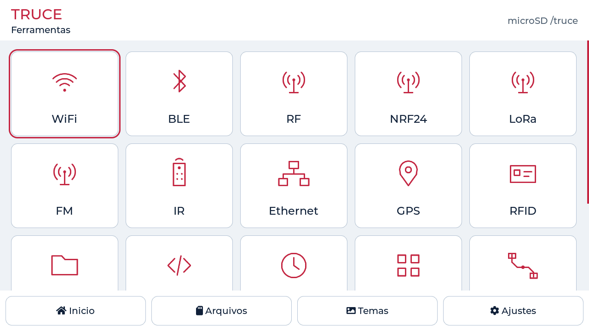
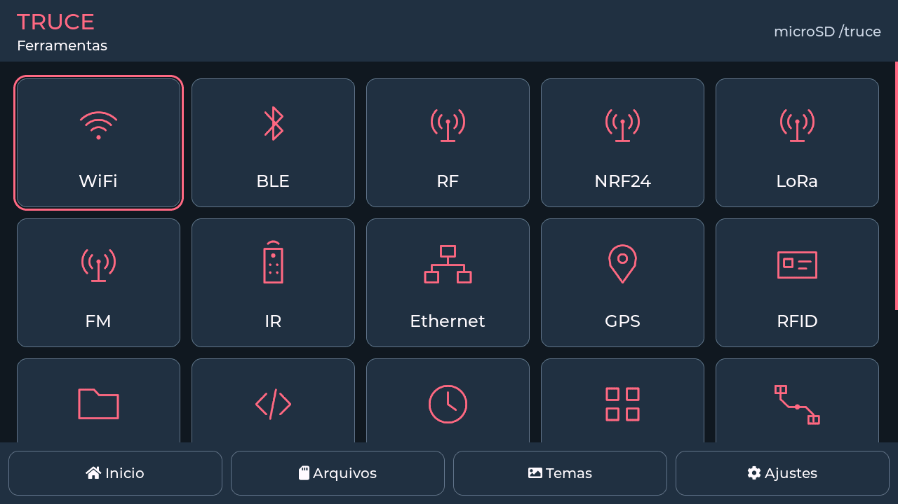
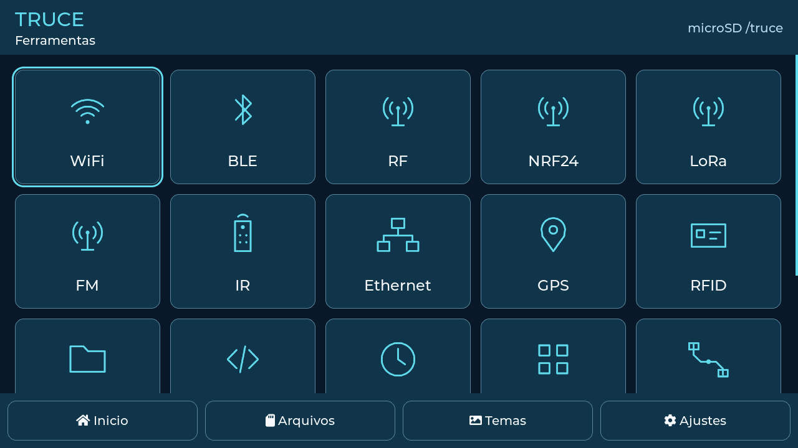
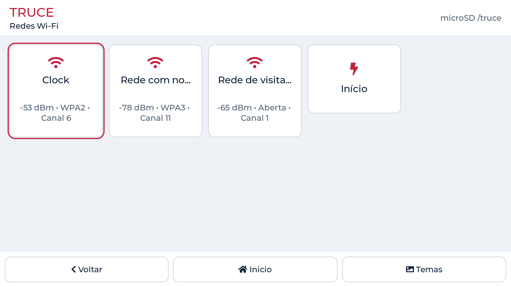
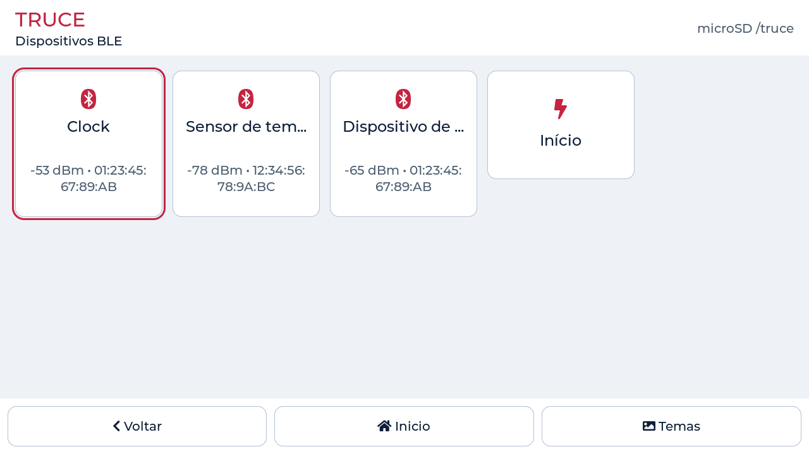
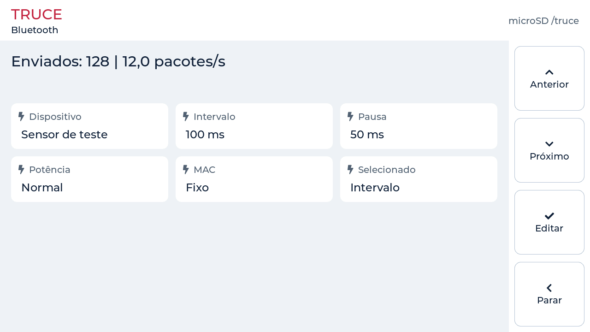
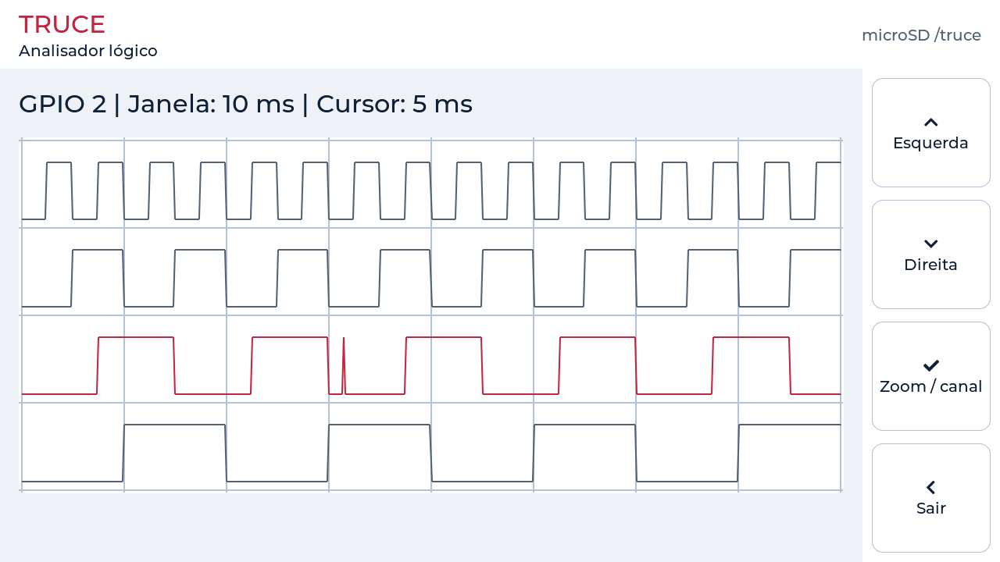

# Truce for M5Stack Tab5

[Português (Brasil)](README.md) · **English** · [Technical documentation in Portuguese](TRUCE_TAB5.md)

Truce adapts [Bruce](https://github.com/BruceDevices/Firmware) for the **M5Stack Tab5**, with an **LVGL 9.3** interface, icon tiles, three themes, and microSD storage under **`/truce`**. Its visual reference is Launcher_do_Paludo. This repository contains the Tab5-specific changes; upstream documentation and credits are preserved in the [original Bruce README](README_BRUCE.md).



**License:** [AGPL-3.0-or-later](LICENSE), matching upstream Bruce. This is a modified version; changes dated 2026-11-16 and original attribution are recorded in [NOTICE.md](NOTICE.md).

## Interface and navigation

- A tile-based home screen and menus, with touch and keyboard navigation.
- **Graphite**, **Ocean**, and **Light** themes, with icons and supplementary fonts on microSD.
- Execution screens with larger status text and buttons on the right. Available actions follow each module's existing commands.
- Scrollable panels with up to 48 fields for readings, settings, and device information.
- Wi-Fi/BLE lists with signal strength and metadata; confirmations, details, and packets displayed through LVGL components.
- Native interfaces for SSH, Telnet and UART terminals, text readers, spectrum and waterfall views, clock, timer, logic analyzer, and the Megalodon game.
- Brazilian Portuguese translations for interface text. Network names, addresses, filenames, commands, and captured data retain their original values.

Built-in menu actions start with an LVGL panel. The shared border and dynamic screen titles also use this format. External JavaScript applications retain control of their own graphics.

### Themes

| Graphite | Ocean | Light |
| --- | --- | --- |
|  |  |  |

### Networks and devices

| Wi-Fi networks | BLE devices |
| --- | --- |
|  |  |

Tiles separate names from metadata. Full information and available actions appear in the corresponding detail screens and menus.

### Execution and instruments

| Bluetooth panel | Logic analyzer |
| --- | --- |
|  |  |

The logic analyzer displays up to four channels and keeps transitions narrower than a graph column visible. Panel data scrolls independently of the fixed side controls.

**All images above are LVGL emulator captures with synthetic data.** They demonstrate presentation without running radio connections, attacks, or peripherals. The Bluetooth example renders the panel component using demonstration data. Screenshots show the current Portuguese interface; this English README does not imply an English UI language selector.

## Image gallery

The [imagens](imagens/) folder contains **748 PNGs** across three themes, at **1280×720** and **720×1280**:

| Collection | Images | Content |
| --- | ---: | --- |
| Screens | 154 | Native components, navigation and test states |
| Review | 72 | Readable examples of 12 screens with synthetic data |
| Stress catalog | 522 | 87 titles rendered in the shared 48-field panel |

Open **[imagens/index.html](imagens/index.html)** locally to search screens and filter by theme, orientation, and collection. On GitHub, open individual PNGs or download the folder to use the gallery. The [manifest](imagens/manifesto.json) records dimensions, provenance, and hashes. The stress catalog validates the shared panel; it does not represent execution of all 87 modules.

## Installing on Tab5

The current build uses **`esp32p4_es`** and has booted on an **ESP32-P4 revision 1.3** device. Other silicon revisions require a compatibility check before flashing.

1. Copy the **entire `sdcard/truce` directory** to the root of a FAT32 microSD card. The resulting paths should include `/truce/config`, `/truce/themes`, `/truce/fonts`, and so on.
2. With **Launcher_do_Paludo**, install **`Truce-Tab5-app.bin`**, the application-only image available in `dist/` after packaging.
3. Insert the microSD card and open the application from the Launcher. Without a card, the application displays a recovery screen and waits.

**Do not flash the combined image at address `0x0` on a device with a Launcher.** It replaces the bootloader and partition table. Standalone installation without a Launcher follows a separate procedure in the [technical guide](TRUCE_TAB5.md#instalação-direta-sem-launcher).

For USB maintenance that preserves the Launcher, the utility reads the actual device partition table and checks the slot's capacity before writing:

```sh
python3 tools/flash_truce_slot.py --port <serial-port> --slot <truce-slot> --dry-run
python3 tools/flash_truce_slot.py --port <serial-port> --slot <truce-slot>
```

Select the existing Truce slot. Do not reuse flash addresses from another installation.

## Files and settings

```text
/truce/
  config/                  Interface, module and pin settings
  boot/shark.png           Startup image
  fonts/                   Supplementary and instrument fonts
  themes/                  JSON themes and icons
  preferences/             Module preferences
  logs/                    Logs
  apps_data/               Application data
```

Persistent application settings and files live on microSD. Truce does not use flash-backed NVS, SPIFFS, or LittleFS to store this data. Legacy LittleFS accesses are redirected to microSD. Executable firmware remains in flash; the Launcher's own partitions are preserved when updating the application.

Legacy module paths are relative to `/truce`. Additional resources from `sd_files` must be copied inside that directory. See the [technical guide](TRUCE_TAB5.md) for the complete structure and persistence details.

## Building, testing and exporting images

Clone the repository with its submodules before building:

```sh
git clone --recurse-submodules https://github.com/tpklge/Tab5Truce.git
cd Tab5Truce
```

Run from the repository root with PlatformIO, CMake, and a C/C++ compiler installed:

```sh
pio run -e m5stack-tab5
cmake -S tests/truce -B /tmp/truce-ui-host
cmake --build /tmp/truce-ui-host -j 6
ctest --test-dir /tmp/truce-ui-host --output-on-failure
python3 tools/check_truce_assets.py
python3 tools/check_truce_storage.py
python3 tools/export_truce_images.py --source /tmp/truce-ui-host/screenshots
python3 tools/package_truce.py
```

Building the firmware provides the LVGL dependencies used by the simulator. The simulator compiles the same `ui_view.cpp` as the firmware with **AddressSanitizer and UndefinedBehaviorSanitizer**. The exporter converts the framebuffer into PNG and uses the latest run's capture index to exclude stale files.

The generated package is `dist/Truce-Tab5.zip`. It contains firmware images for different installation procedures: choose the application-only image when using the Launcher.

## Validation and limitations

| Check | Recorded result |
| --- | --- |
| Simulated layout and navigation | **812 scenarios and 1,174 taps**, three themes and two orientations |
| Emulator captures | **748 PNGs**, with manifest and gallery |
| Boot on Tab5 revision 1.3 | Menu reached **2.17 s** after application startup; excludes the Launcher |
| Internal memory after navigation | Approximately **225 KB free** |
| On-device menus | Wi-Fi, BLE, wire tools, settings, utilities and files, navigated using serial commands |
| Idle observation | 30 seconds, with no post-startup reset or unexpected selection during the test |

Hardware results are in [boot-hardware.json](artifacts/truce-ui/boot-hardware.json), and simulator results are in [simulation.txt](artifacts/truce-ui/simulation.txt). This review did not execute attacks or validate radio connections, external peripherals, or physical finger input. The current Tab5 backend keeps speaker and microphone support disabled; the existence of audio screens does not establish working audio support.

## Upstream and license

Based on [BruceDevices/Firmware](https://github.com/BruceDevices/Firmware), with thanks to its authors and contributors. Original credits and documentation: [README_BRUCE.md](README_BRUCE.md). Dependency attribution: [THIRD_PARTY.md](THIRD_PARTY.md). Repository license: [GNU AGPL v3 or later](LICENSE).
