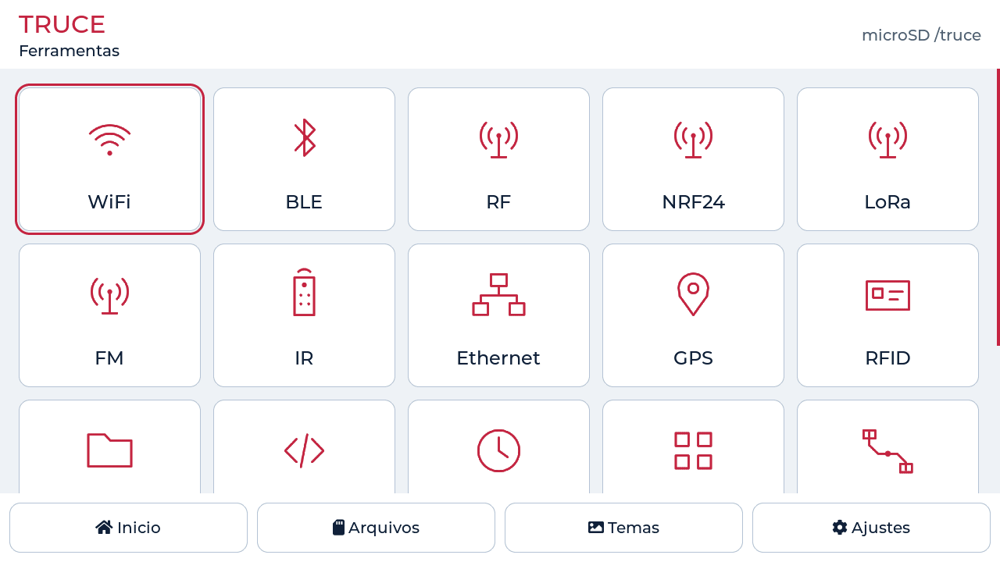
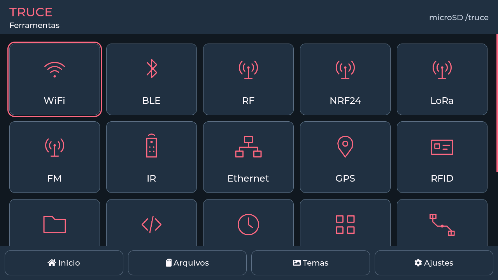
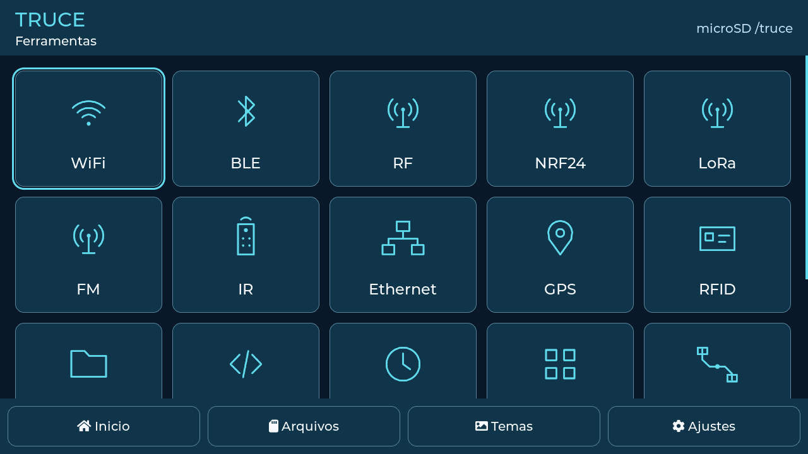
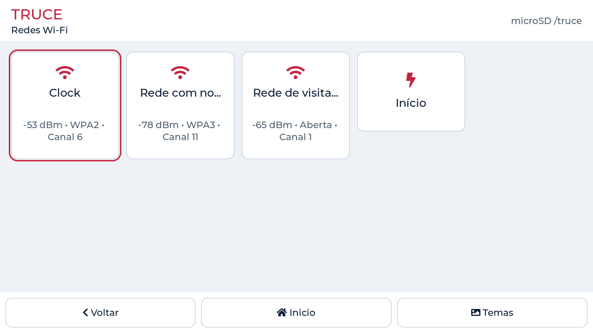
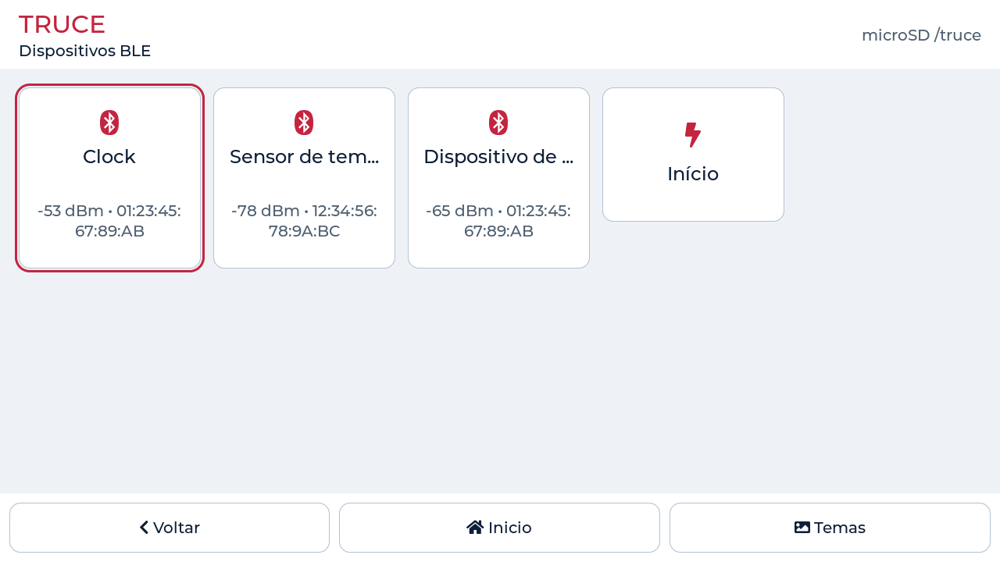
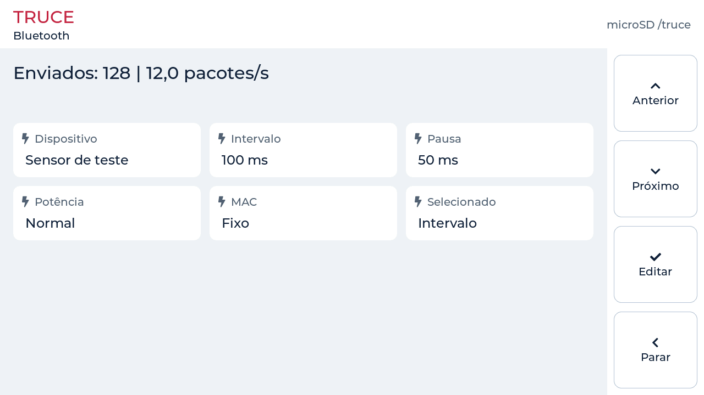
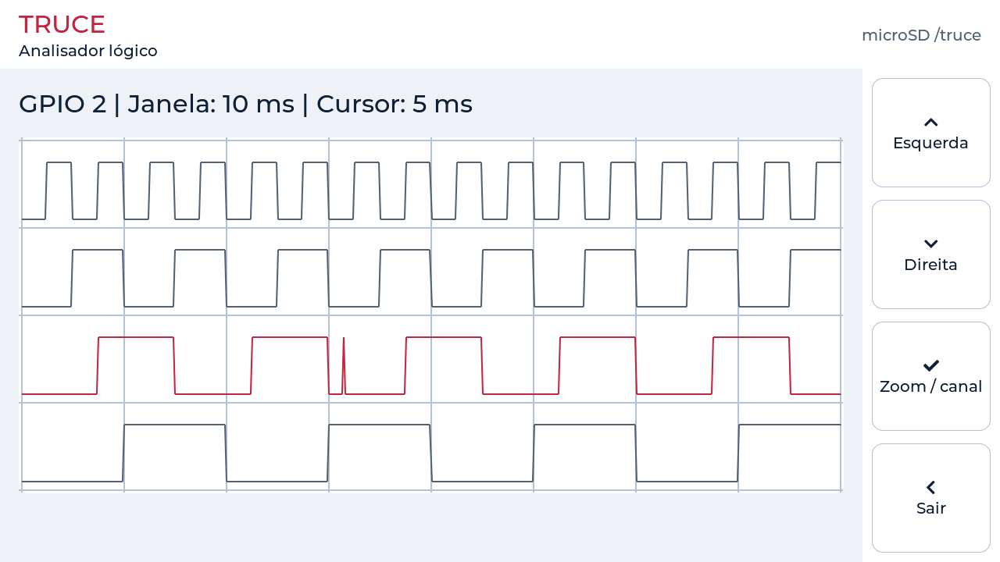

# Truce para M5Stack Tab5

**Português (Brasil)** · [English](README.en.md) · [Documentação técnica](TRUCE_TAB5.md)

Truce é uma adaptação do [Bruce](https://github.com/BruceDevices/Firmware) para o **M5Stack Tab5**, com interface em **LVGL 9.3**, cartões com ícones, três temas e arquivos no microSD em **`/truce`**. O visual usa o Launcher_do_Paludo como referência. Este repositório contém as alterações específicas do Tab5; a documentação e os créditos do projeto de origem estão preservados no [README original do Bruce](README_BRUCE.md).



**Licença:** [AGPL-3.0-or-later](LICENSE), a mesma do Bruce original. Esta é uma versão modificada; as alterações de 16/11/2026 e os créditos estão registrados em [NOTICE.md](NOTICE.md).

## Interface e navegação

- Tela inicial e menus em cartões, com navegação por toque e teclado.
- Temas **Grafite**, **Oceano** e **Claro**, com ícones e fontes de apoio no microSD.
- Telas de execução com status ampliado e botões na lateral direita. As ações disponíveis seguem os comandos de cada módulo.
- Painéis com até 48 campos roláveis para leituras, configurações e informações de dispositivos.
- Listas Wi-Fi/BLE com sinal e metadados; confirmações, detalhes e pacotes em componentes LVGL.
- Terminais SSH, Telnet e UART, leitores de texto, espectros, cascata, relógio, temporizador, analisador lógico e jogo Megalodon com interfaces nativas.
- Tradução de textos da interface para pt-BR. Nomes de redes, endereços, arquivos, comandos e dados capturados são preservados.

As opções internas de menu começam em um painel LVGL. A moldura compartilhada e os títulos dinâmicos também usam esse padrão. Scripts JavaScript externos continuam controlando seus próprios desenhos.

### Temas

| Grafite | Oceano | Claro |
| --- | --- | --- |
|  |  |  |

### Redes e dispositivos

| Redes Wi-Fi | Dispositivos BLE |
| --- | --- |
|  |  |

Os cartões separam o nome dos metadados. As informações completas e as ações ficam nas telas de detalhes e nos menus correspondentes.

### Execução e instrumentos

| Painel Bluetooth | Analisador lógico |
| --- | --- |
|  |  |

O analisador lógico apresenta até quatro canais e mantém visíveis transições menores que uma coluna do gráfico. Nos painéis, a área de dados rola sem deslocar os controles laterais.

**Todas as imagens acima são capturas da emulação LVGL com dados sintéticos.** Elas demonstram a apresentação, sem executar conexões de rádio, ataques ou periféricos. O exemplo Bluetooth usa o componente de painel com dados de demonstração.

## Galeria de imagens

A pasta [imagens](imagens/) contém **748 PNGs** nos três temas, em **1280×720** e **720×1280**:

| Conjunto | Imagens | Conteúdo |
| --- | ---: | --- |
| Telas | 154 | Componentes nativos, navegação e estados de teste |
| Revisão | 72 | Exemplos legíveis de 12 telas, com dados sintéticos |
| Catálogo de estresse | 522 | 87 títulos no painel compartilhado de 48 campos |

Abra **[imagens/index.html](imagens/index.html)** localmente para buscar telas e filtrar por tema, orientação e conjunto. Na visualização do GitHub, abra os PNGs diretamente ou baixe a pasta para usar a galeria. O [manifesto](imagens/manifesto.json) registra dimensões, origem e hashes. O catálogo de estresse valida o painel compartilhado; não representa a execução dos 87 módulos.

## Instalação no Tab5

O build atual usa **`esp32p4_es`** e foi inicializado em um **ESP32-P4 revisão 1.3**. Outras revisões de silício precisam de verificação de compatibilidade antes da gravação.

1. Copie a pasta **`sdcard/truce` inteira** para a raiz de um microSD FAT32. O resultado deve ser `/truce/config`, `/truce/themes`, `/truce/fonts` etc.
2. Com o **Launcher_do_Paludo**, instale **`Truce-Tab5-app.bin`**, a imagem que contém somente a aplicação, disponível em `dist/` após o empacotamento.
3. Insira o microSD e abra o aplicativo pelo Launcher. Sem cartão, a aplicação mostra a tela de recuperação e aguarda.

**Não grave a imagem combinada no endereço `0x0` de um dispositivo com Launcher.** Ela substitui o bootloader e a tabela de partições. A instalação direta, sem Launcher, usa outro procedimento, descrito no [guia técnico](TRUCE_TAB5.md#instalação-direta-sem-launcher).

Para manutenção por USB preservando o Launcher, o utilitário lê a tabela real de partições e verifica o espaço do slot antes de gravar:

```sh
python3 tools/flash_truce_slot.py --port <porta-serial> --slot <slot-do-truce> --dry-run
python3 tools/flash_truce_slot.py --port <porta-serial> --slot <slot-do-truce>
```

Selecione o slot existente do Truce. Não reutilize endereços de flash de outra instalação.

## Arquivos e configurações

```text
/truce/
  config/                  Configurações da interface, módulos e pinos
  boot/shark.png           Imagem da abertura
  fonts/                   Fontes de apoio e mostradores
  themes/                  Temas JSON e ícones
  preferences/             Preferências dos módulos
  logs/                    Registros
  apps_data/               Dados dos aplicativos
```

Configurações e arquivos persistentes da aplicação ficam no microSD. O Truce não usa NVS, SPIFFS ou LittleFS na flash para armazenar esses dados. Os acessos legados a LittleFS são redirecionados ao microSD. O firmware executável permanece na flash; as partições próprias do Launcher são preservadas na atualização da aplicação.

Os caminhos antigos dos módulos são relativos a `/truce`. Recursos adicionais de `sd_files` devem ser copiados para dentro dessa pasta. Consulte o [guia técnico](TRUCE_TAB5.md) para a estrutura completa e os detalhes da persistência.

## Compilar, testar e gerar imagens

Antes de compilar, clone o repositório com os submódulos:

```sh
git clone --recurse-submodules https://github.com/tpklge/Tab5Truce.git
cd Tab5Truce
```

Execute na raiz deste repositório, com PlatformIO, CMake e um compilador C/C++ instalados:

```sh
pio run -e m5stack-tab5
cmake -S tests/truce -B /tmp/truce-ui-host
cmake --build /tmp/truce-ui-host -j 6
ctest --test-dir /tmp/truce-ui-host --output-on-failure
python3 tools/check_truce_assets.py
python3 tools/check_truce_storage.py
python3 tools/export_truce_images.py --source /tmp/truce-ui-host/screenshots
python3 tools/package_truce.py
```

A compilação do firmware disponibiliza as dependências LVGL usadas pelo simulador. O simulador compila o mesmo `ui_view.cpp` do firmware com **AddressSanitizer e UndefinedBehaviorSanitizer**. A exportação converte o framebuffer em PNG e usa o índice da última execução para excluir capturas antigas.

O pacote gerado é `dist/Truce-Tab5.zip`. Ele inclui imagens de firmware para procedimentos distintos: escolha a imagem de aplicação ao usar o Launcher.

## Validação e limites

| Verificação | Resultado registrado |
| --- | --- |
| Layout e navegação simulados | **812 cenários e 1.174 toques**, três temas e duas orientações |
| Capturas da emulação | **748 PNGs**, com manifesto e galeria |
| Inicialização no Tab5 revisão 1.3 | Menu em **2,17 s** após o início da aplicação; não inclui o Launcher |
| Memória interna após navegação | Aproximadamente **225 KB livres** |
| Menus no aparelho | Wi-Fi, BLE, ferramentas de fio, configurações, utilitários e arquivos, por comandos seriais |
| Observação em repouso | 30 segundos, sem reinício após a inicialização ou seleção inesperada no teste |

Os resultados de hardware estão em [boot-hardware.json](artifacts/truce-ui/boot-hardware.json), e os testes simulados em [simulation.txt](artifacts/truce-ui/simulation.txt). A revisão não executou ataques nem validou conexões de rádio, periféricos externos ou toque físico com o dedo. Alto-falante e microfone permanecem desabilitados no backend atual do Tab5; a existência das telas de áudio não comprova suporte funcional de áudio.

## Origem e licença

Baseado no [BruceDevices/Firmware](https://github.com/BruceDevices/Firmware), com agradecimento aos seus autores e contribuidores. Créditos e documentação originais: [README_BRUCE.md](README_BRUCE.md). Atribuições de dependências: [THIRD_PARTY.md](THIRD_PARTY.md). Licença do repositório: [GNU AGPL v3 ou posterior](LICENSE).
